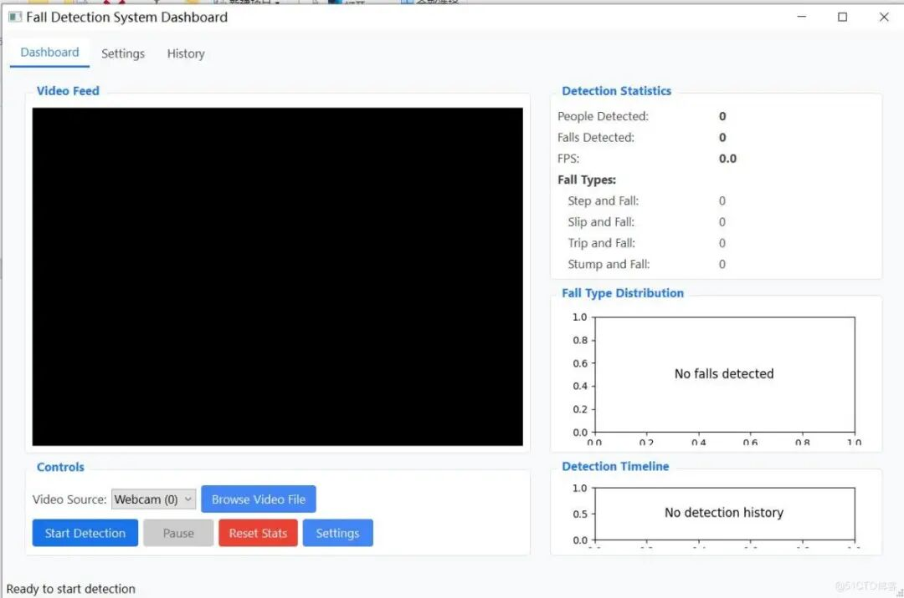
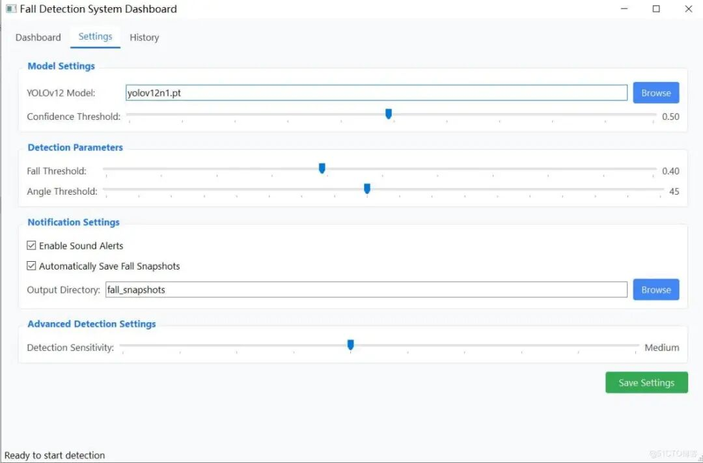

# Human Fall Detection System Based on YOLOv12 and MediaPipe

Interface Preview: A real-time fall detection system using computer vision technology, employing YOLOv12 for human detection and MediaPipe for posture.

Interface Preview:





A real-time fall detection system using computer vision technology, employing YOLOv12 for human detection and MediaPipe for pose estimation. The system features an intuitive dashboard for monitoring and analyzing fall incidents.

### Function Characteristics

- **Real-time detection**

Real-time processing of video streams from network cameras or video files.

- **Fall Types Classification**

Differentiate four types of falls: tripping, slipping, falling, and tripping over

- **Modern PyQt5 Dashboard**

User-friendly interface with statistical information, charts, and historical record tracking.

- **Multi-person detection**

: Track and analyze multiple individuals simultaneously.

- **Advanced Posture Analysis**

Monitor key body points (shoulders, hips, feet) to accurately assess falls.

- **Adjustable Sensitivity**

: Adjusting detection thresholds for different environments

- **Intelligent Fall Counting**

: Prevents recounting by personnel tracking and cooling time

- **Automatic Fall Snapshots**

Detection of falls and capture and storage of images

- **Sound Alarm**

Detection of a fall and audio notification

- **Command line mode**

: Supports headless command-line mode for deployment.

### System Requirements

-

Python 3.7-3.10 (Python 3.11+ may have compatibility issues with certain dependencies)

-

PyTorch

-

OpenCV

-

MediaPipe

-

Ultralytics (YOLOv12)

-

PyQt5

-

Matplotlib

-

NumPy

### Installation Guide

1.

Download source code:

1.

Install dependencies:

```
pip install -r requirements.txt
```

1.

Install PyQt5 (if it is not included in the requirements):

```
pip install PyQt5==5.15.10 PyQt5-Qt5==5.15.2 PyQt5-sip==12.13.0 matplotlib
```

1.

Download the YOLOv12 model (automatically downloaded during the first run, or manually placed in the project root directory)

### Usage Method

Dashboard mode (recommended)

```
python fall_detection_system.py --mode dashboard
```

#### Command line mode

```
python fall_detection_system.py --mode cli --source 0
```

#### Option parameters

- `--mode`

Application mode (`dashboard` or `cli`)

- `--model`

YOLOv12 model file path (default: `yolov12n1.pt`)

- `--conf`

Detection confidence threshold (0-1)

- `--source`

Video source (0 represents a network camera or video file path)

- `--fall-threshold`

Fall detection sensitivity threshold (0-1)

- `--angle-threshold`

Body angle threshold (0-90 degrees)

- `--save-falls`

Detection of saved frames when falling down.

- `--output-dir`

: Directory for saving the crash snapshots

### System Architecture

The system consists of several key components:

1. **YOLOv12 Human Detection**

Identify human body in video frames

1. **MediaPipe Pose Estimation**

Extracting bone data from detected human body

1. **Fall Detection Algorithm**

Analyze posture data to detect falls, including:

-

Body angle relative to the vertical

-

Body axial ratio (horizontal and vertical directions)

-

Abrupt vertical position change

-

Motion mode analysis

1. **Personnel Tracking**

Cross-frame tracking for personal identification

1. **PyQt5 Dashboard**

Provide real-time monitoring and analysis

### Fall Classification Standards

- **Stumble**

Gradual angle changes with moderate speed

- **Slip**

Rapid angle changes with high speed

- **Falling**

Forward momentum companion with medium angle change

- **Falling**

Minimum horizontal movement with significant vertical descent

### Project Structure

```
fall-detection-system/
├── models/
└── fall_detector.py # Core Fall Detection Model
├── dashboard/
└── dashboard_app.py # PyQt5 Dashboard UI Application
├── utils/
└── utils.py # Tool functions
├── fall_snapshots/ # Fall Snapshots directory
├── fall_detection_system.py  # Main application script
├── README.md  # Project documentation
└── requirements.txt  # Project dependencies
```

### Recent improvements

-

Enhanced the fall detection algorithm, adopting stricter standards.

-

Cooling time added to prevent re-counting of falls

-

Improved sensitivity control for different environments

-

Added comprehensive fall type classification

-

Improved keypoint detection for more accurate pose analysis

-

Improved error handling for camera access and processing

-

Optimized snapshot saving to reduce disk usage

-

Transition from Tkinter to PyQt5 for a more modern interface


## Payment

Here is a pay link on Stripe ( https://buy.stripe.com/3cs8yP7sY87d0vu9AB ). Please contact me lonlonago@foxmail.com after funding $89, and I will send you a complete data files , thank you!


